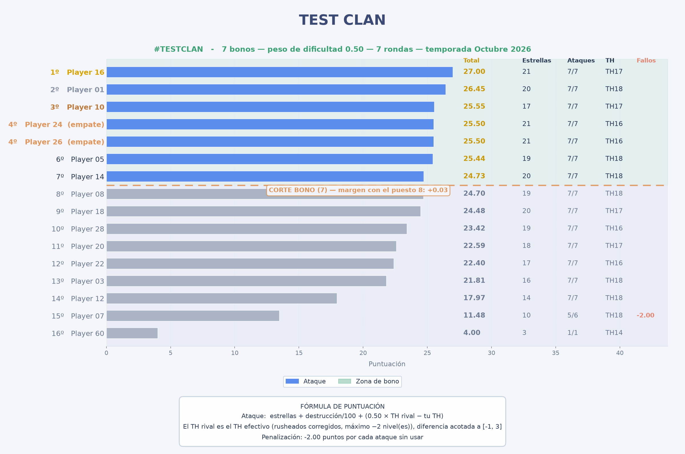

<div align="center">

# 🏆 Clash of Clans: Calculadora de Bonos CWL

**Reparto justo y auditable de medallas de bono en la Liga de Guerras de Clanes — directo desde la API oficial.**

[](https://www.python.org/)
[](LICENSE)
[](tests/)

[English](README.md) · [Español](README.es.md)

</div>



*Los nombres de la imagen son ficticios — ver [`tools/make_fixture.py`](tools/make_fixture.py).*

---

## Qué es

Cada temporada de CWL termina igual: *¿quién merece las medallas de bono?* La mayoría de clanes lo resuelven con una hoja de cálculo, o con "el que más estrellas sacó", o con el que más protesta. Las tres respuestas fallan, cada una a su manera.

Esta herramienta lee tu temporada directamente desde la API oficial de Clash of Clans — **sin exportar CSV, sin capturas, sin meter datos a mano** — puntúa a cada jugador con una fórmula que puedes inspeccionar y ajustar, y genera una tabla de ranking más una infografía lista para compartir en el chat del clan.

Existe porque una fórmula solo es justa si se ve qué premia. Cada peso es configurable, cada número del ranking se puede rastrear, y la herramienta te dice cuándo **no** puede decidir algo en lugar de decidirlo por ti.

## Características

- 🚀 **Cero entrada manual de datos.** Inicia sesión, encuentra tu grupo de liga y lee cada guerra, cada ataque y cada defensa. No hay nada que exportar.
- ⚖️ **Peso de dificultad configurable.** Atacar una base más fuerte paga más; atacar una más débil paga menos. El peso lo eliges tú, y vienen tres preajustes.
- 🏰 **Corrección de rusheados.** Un Ayuntamiento colocado por debajo de Ayuntamientos más bajos en el mapa rival es uno que el propio juego ordenó como débil: cuenta como ese Ayuntamiento más bajo, así que farmear una base rusheada no da puntos gratis.
- 🚫 **Los ataques sin usar se cobran, nunca se esconden.** −2.00 por ataque no realizado, siempre visibles en su propia columna y nunca recortados para parecer un cero.
- 🤝 **Empates de verdad.** Las puntuaciones iguales comparten puesto. Si un empate cae justo en el corte del bono, la herramienta **lo avisa** en lugar de elegir a alguien en silencio.
- 🧑⚖️ **Reglas de elegibilidad.** Opcionalmente exige un mínimo de guerras para que un suplente de una ronda no le quite el bono a un titular de siete.
- 🛡️ **Puntuación defensiva opcional**, desactivada por defecto, medida por defensa para que recibir más ataques no valga automáticamente más.
- 🌍 **i18n desde el primer día.** Inglés y español disponibles; añadir un idioma es un fichero JSON.
- 📊 **Infografía** con la zona de bono sombreada, medallas, estadísticas por jugador y el margen con el puesto de corte.
- ✅ **102 tests**, incluidos tests de regresión contra una temporada real de 7 rondas.

## Cómo funciona la puntuación

Cada ataque vale:

```
puntos = estrellas + (destrucción / 100) + (peso_dificultad × diferencia de Ayuntamiento acotada)
```

donde la diferencia es *TH efectivo del rival − tu TH*, corregida para rusheados y acotada a `[-1, +3]`.

- **Total = la suma de todos los ataques, más la penalización por fallos.**
- `estrellas + destrucción` abarca unos 0–4 puntos por ataque; el término de dificultad abarca unos ±0.9 con el peso por defecto. Las estrellas mandan — la dificultad decide temporadas ajustadas, que es para lo que está.
- El suelo del acotado en −1 es deliberado: normaliza la fuerza del rival. Cuando todo el clan rival es más débil que el tuyo, cada jugador recibe el mismo pequeño descuento en vez de una penalización profunda que nadie podría evitar.

Razonamiento completo, ejemplos y las mediciones detrás de los valores por defecto: **[docs/SCORING.md](docs/SCORING.md)**.

## Instalación

Requiere Python 3.10 o superior.

```bash
git clone https://github.com/GARTOLO/cwl-bonus-calculator.git
cd cwl-bonus-calculator
python3 -m venv .venv
source .venv/bin/activate        # Windows: .venv\Scripts\activate
pip install -e .
```

O con requirements:

```bash
pip install -r requirements.txt
```

## Configuración

Crea una cuenta de desarrollador en <https://developer.clashofclans.com> (gratis) y genera una clave de API. **Cada clave está ligada a una dirección IP** — si ejecutas la herramienta desde otra red, crea una clave nueva.

```bash
cp .env.example .env
```

```env
COC_EMAIL="tu@ejemplo.com"           # la cuenta de desarrollador, no tu Supercell ID
COC_PASSWORD="tu-password-de-api"
CLAN_TAG="%232PP0JCCCV"              # "#2PP0JCCCV" también funciona
```

`.env` está en el .gitignore. No lo subas nunca.

## Uso

```bash
cwl-bonus --lang es                  # 7 bonos, salida en español
cwl-bonus --lang es --bonuses 5      # otra cantidad de medallas
cwl-bonus --lang es -d               # incluir la puntuación defensiva
cwl-bonus --lang es --preset hard-target   # premiar más atacar hacia arriba
cwl-bonus --lang es --min-wars 4     # solo quienes jugaron 4+ guerras optan a bono
cwl-bonus --lang es --difficulty 0.75      # ajustar fino el peso de dificultad
cwl-bonus --lang es --config mis-pesos.json
cwl-bonus --lang es --debug          # volcar también la temporada cruda
```

Equivale a `python -m cwlbonus ...` si prefieres no instalar el ejecutable.

### Preajustes

| Preajuste | Peso de dificultad | Comportamiento |
|---|---|---|
| `stars` | `0.0` | Mérito puro: solo estrellas y destrucción. La dificultad se ignora por completo. |
| `balanced` *(por defecto)* | `0.5` | Atacar fuerte paga, pero un 3 estrellas limpio sigue ganando a un 1 estrella heroico. |
| `hard-target` | `1.0` | Atacar sistemáticamente más fuerte que tu espejo puede subirte varios puestos. |

El valor por defecto es `balanced` porque, medido contra una temporada real, un peso de dificultad de `0.3` daba **exactamente los mismos beneficiarios de bono** que ignorar la dificultad por completo: el término estaba bien puesto, pero era demasiado pequeño para importar. Los números están en [docs/SCORING.md](docs/SCORING.md).

### Todas las opciones

| Opción | Defecto | Significado |
|---|---|---|
| `--bonuses N` | `7` | Medallas a repartir. |
| `-d`, `--defense` | desactivado | Incluir la puntuación por defensa. |
| `--preset NAME` | `balanced` | `stars`, `balanced` o `hard-target`. |
| `--difficulty X` | `0.5` | Puntos por nivel de Ayuntamiento de diferencia, por ataque. |
| `--rusher-cap N` | `2` | Máximo de niveles que puede quitar la corrección de rusheados. `0` la desactiva. |
| `--min-wars N` | `0` | Mínimo de guerras jugadas para optar a bono. |
| `--no-defense-policy P` | `neutral` | Puntuación de quien no fue atacado: `neutral`, `min` (el peor observado) o `max`. |
| `--output DIR` | `./output` | Carpeta del gráfico y los ficheros de depuración. |
| `--lang CODE` | auto | Idioma de salida. Tiene prioridad sobre `CWL_LANG`. |
| `--config FILE` | – | Fichero JSON que sobrescribe cualquier peso. |
| `--debug` | desactivado | Escribe la temporada cruda descargada en JSON. |
| `--list-langs` | – | Muestra los idiomas disponibles y sale. |

### Fichero de configuración

Cualquier subconjunto de los pesos, en JSON:

```json
{
  "difficulty": 0.6,
  "difficulty_clamp": [-1.0, 3.0],
  "rusher_max_cut": 2,
  "missed_attack": -2.0,
  "use_defense": false,
  "no_defense_policy": "neutral",
  "min_wars": 0,
  "bonuses": 7
}
```

Las opciones de línea de comandos tienen prioridad sobre el fichero, que tiene prioridad sobre el preajuste.

## Salida

`output/ranking_final_api.png` — la infografía, lista para Discord o WhatsApp:

- zona de bono sombreada, medallas en el podio y el margen con el puesto de corte
- por jugador: estrellas, ataques usados/guerras jugadas, Ayuntamiento y penalización
- la fórmula activa impresa en el gráfico, para que nadie tenga que preguntar qué pesos se usaron
- los empates etiquetados, no ordenados en silencio

`output/season_debug.json` — con `--debug`. La temporada completa descargada, para que cualquiera pueda rehacer los números a mano. **Contiene nombres reales de jugadores; no lo subas nunca.**

## Idiomas

Hoy hay inglés y español. Añadir otro es un fichero:

```bash
cp src/cwlbonus/locales/en.json src/cwlbonus/locales/xx.json
# traduce los valores, ajusta _meta.language y _meta.name
```

`tests/test_i18n.py` falla si a un catálogo le faltan claves o le sobran, así que una traducción a medias no puede colarse por accidente.

## Desarrollo

```bash
pip install -e ".[dev]"
pytest                             # 102 tests
pytest tests/test_scoring.py -v    # solo las reglas de puntuación
```

La batería de tests incluye `tests/fixtures/season_sample.json`: una temporada real de 7 rondas de CWL con todos los nombres sustituidos. Conserva la distribución real de Ayuntamientos, el comportamiento real de espejos (97% de espejos exactos), 11 bases rusheadas, un jugador que no atacó y un suplente tardío — así las reglas se prueban contra la realidad y no contra números cómodos. Regenera la tuya con:

```bash
python tools/make_fixture.py mi_temporada.json tests/fixtures/season_sample.json
```

## Límites conocidos

Honestos, para que decidas si te afectan:

- **Solo la temporada actual o recién terminada.** La API oficial no expone grupos de liga pasados, así que no se pueden revisar los bonos del mes anterior.
- **Totales acumulados, no medias.** Quien entró en la ronda 6 no puede superar a un titular de siete rondas. Es intencionado — usa `--min-wars` si quieres que se exija explícitamente y no de forma implícita.
- **El tamaño de equipo es el que devuelva la API.** Funcionan tanto 15v15 como 30v30; el gráfico muestra hasta 30.
- **La clave de API está ligada a una IP.** Un despliegue alojado necesita una clave creada para la IP del servidor.
- **La puntuación defensiva sigue siendo una decisión política.** En CWL, que te ataquen mucho es en parte un cumplido, así que ni "premiar el volumen" ni "premiar la eficiencia" es indiscutiblemente correcto. La herramienta mide eficiencia y te deja la decisión.

## Contribuir

Se aceptan issues y pull requests. Si cambias las matemáticas, cambia también `docs/SCORING.md` y añade un test que muestre el comportamiento nuevo — el sentido de este proyecto es que el ranking se pueda explicar.

## Licencia

MIT — ver [LICENSE](LICENSE).

<div align="center">
<sub>Sin afiliación ni respaldo de Supercell. Clash of Clans es una marca registrada de Supercell Oy.</sub>
</div>
