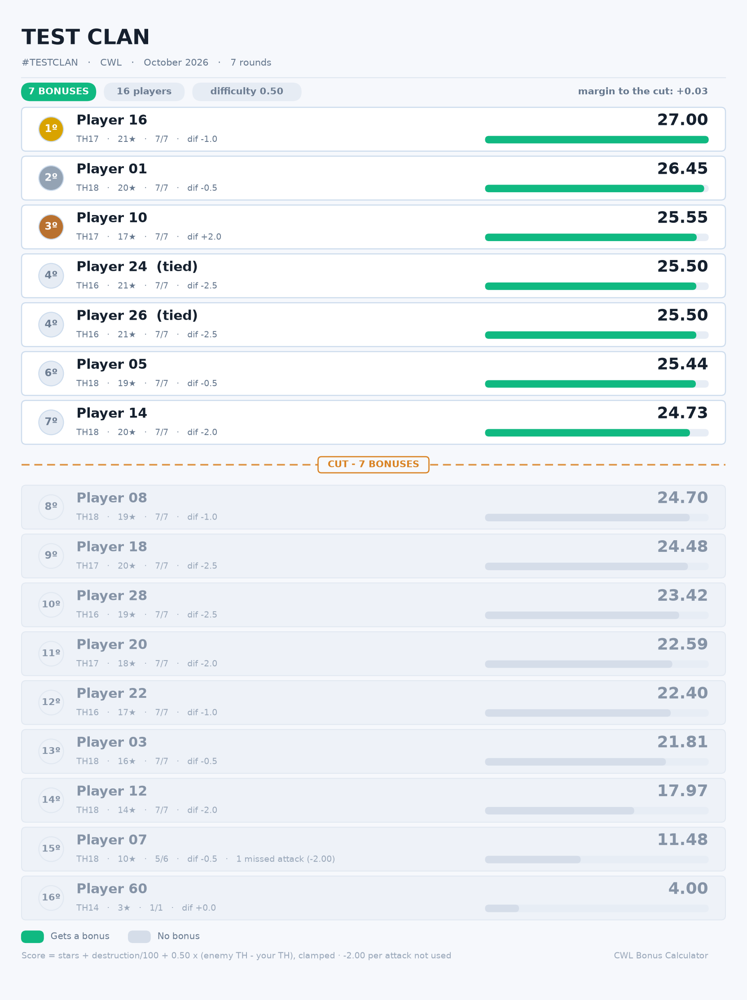

<div align="center">

# 🏆 Clash of Clans: CWL Bonus Calculator

**Fair, auditable bonus medal distribution for Clan War Leagues — straight from the official API.**

[](https://www.python.org/)
[](LICENSE)
[](tests/)

[English](README.md) · [Español](README.es.md)

</div>


*Names in the image above are placeholders — see [`tools/make_fixture.py`](tools/make_fixture.py).*

---

## What it is

Every CWL season ends the same argument: *who deserves the bonus medals?* Most clans answer it with a spreadsheet, or with "the guy who got the most stars", or with whoever complains loudest. All three are wrong in different ways.

This tool reads your season directly from the official Clash of Clans API — **no CSV exports, no screenshots, no manual entry** — scores every player with a formula you can inspect and tune, and produces a ranking table plus a shareable infographic for the clan chat.

It exists because a scoring formula is only fair if you can see what it rewards. Every weight is configurable, every number in the ranking is traceable, and the tool tells you when it *can't* decide something instead of guessing.

## Features

- 🚀 **Zero manual data entry.** Logs in, finds your league group, reads every war, every attack, every defence. Nothing to export.
- ⚖️ **Configurable difficulty weighting.** Attacking a stronger base pays more; attacking a weaker one pays less. The weight is yours to set, and we ship three presets.
- 🏰 **Rushed-base correction.** A Town Hall sitting below weaker Town Halls on the enemy map is one the game itself weighted as weak — it counts as that weaker Town Hall, so farming a rushed base earns no free points.
- 🚫 **Missed attacks are charged, never hidden.** −2.00 per attack not used, always visible in its own column, never clipped away to look like a zero.
- 🤝 **Real tie handling.** Equal scores share a rank. If a tie ever lands on the bonus cut, the tool **says so** instead of silently picking a winner.
- 🧑⚖️ **Eligibility rules.** Optionally require a minimum number of wars so a one-round substitute cannot take a bonus from a seven-round regular.
- 🛡️ **Optional defensive score**, off by default, measured per defence so being attacked more is not automatically worth more.
- 🌍 **i18n from day one.** English and Spanish ship now; adding a language is one JSON file.
- 📊 **A shareable leaderboard.** One card per player: emerald and bright for the ones who get a bonus, dimmed for the rest, medals on the podium, and the margin to the cut. Reads on a phone at chat-app size. Dark and light skins, and the original bar chart is still available as `--style classic`.
- ✅ **154 tests**, including regressions against a real 7-round season.

## How the scoring works

Each attack is worth:

```
points = stars + (destruction / 100) + (difficulty_weight × clamped Town Hall difference)
```

where the Town Hall difference is *their effective TH − your TH*, corrected for rushed bases and clamped to `[-1, +3]`.

- **Total = every attack summed, plus the missed-attack penalty.**
- `stars + destruction` spans roughly 0–4 points per attack; the difficulty term spans about ±0.9 at the default weight. Stars dominate — the difficulty term decides close seasons, which is what it is for.
- The clamp floor of −1 is deliberate: it normalises opponent strength. When the whole enemy clan is weaker than yours, every player takes the same small charge rather than an unavoidable deep penalty.

Full rationale, worked examples and the measurements behind the defaults: **[docs/SCORING.md](docs/SCORING.md)**.

## Installation

Requires Python 3.10 or newer. Python 3.11–3.13 have the widest wheel coverage if a dependency ever fails to build.

There are two ways in. Both need the dependencies; only the second installs the package itself.

**Option A — run it straight from the checkout:**

```bash
git clone https://github.com/GARTOLO/cwl-bonus-calculator.git
cd cwl-bonus-calculator
python3 -m venv .venv          # then activate it, see the table below
pip install -r requirements.txt
python run.py --bonuses 7
```

**Option B — install it properly:**

```bash
pip install -e .
cwl-bonus --bonuses 7          # or: python -m cwlbonus --bonuses 7
```

### Activating the virtualenv

The command depends on your **shell**, not your operating system:

| Shell | Command |
|---|---|
| Linux / macOS (bash, zsh) | `source .venv/bin/activate` |
| Windows PowerShell | `.\.venv\Scripts\Activate.ps1` |
| Windows cmd.exe | `.venv\Scripts\activate.bat` |
| Windows Git Bash | `source .venv/Scripts/activate` |

`source` is a bash builtin — in PowerShell or cmd it is not a command at all, and on Windows the activate script is a `.ps1` or `.bat` file rather than `Scripts/activate`. If PowerShell refuses to run it, allow it for this session only:

```powershell
Set-ExecutionPolicy -Scope Process -ExecutionPolicy Bypass
```

You do not need the venv activated if the dependencies are already installed: `python run.py ...` works from a plain terminal.

## Configuration

Create a free developer account at <https://developer.clashofclans.com>. Your clan's Supercell ID is not involved.

**You do not need to create an API key yourself.** The client logs in with your account credentials, discovers your current public IP, and creates and rotates the keys for you — and if your IP changes mid-run it repairs itself and retries automatically. Just put the account email and password in `.env`.

One caveat: the developer site allows a **maximum of 10 keys per account**. If you have already created ten by hand, delete a couple so there is room.

```bash
cp .env.example .env
```

```env
COC_EMAIL="you@example.com"          # your developer account, not your Supercell ID
COC_PASSWORD="your-api-password"
CLAN_TAG="%232PP0JCCCV"              # "#2PP0JCCCV" works too
```

`.env` is gitignored. Never commit it.

## Usage

`cwl-bonus` below is the installed entry point. Running from the checkout instead, use `python run.py` with the same flags.

```bash
cwl-bonus                            # 7 bonuses, English, default weights
cwl-bonus --bonuses 5                # a different number of medals
cwl-bonus --lang es                  # Spanish output
cwl-bonus -d                         # include the defensive score
cwl-bonus --preset hard-target       # reward attacking up the map harder
cwl-bonus --min-wars 4               # only players with 4+ wars can win a bonus
cwl-bonus --difficulty 0.75          # fine-tune the difficulty weight
cwl-bonus --config my-weights.json   # load a full set of weights from a file
cwl-bonus --debug                    # also dump the raw season for auditing
```

Equivalent to `python -m cwlbonus ...` if you prefer not to install the script.

### Presets

| Preset | Difficulty weight | Behaviour |
|---|---|---|
| `stars` | `0.0` | Pure merit: stars and destruction only. Difficulty is ignored entirely. |
| `balanced` *(default)* | `0.5` | Hard targets pay, but a clean 3-star still beats a heroic 1-star. |
| `hard-target` | `1.0` | Consistently taking harder-than-mirror bases can move you several places. |

The default is `balanced` because, measured against a real season, difficulty weight `0.3` produced **exactly the same bonus recipients** as ignoring difficulty altogether — the correct term was there, but too small to matter. See [docs/SCORING.md](docs/SCORING.md) for the numbers.

### All options

| Flag | Default | Meaning |
|---|---|---|
| `--bonuses N` | `7` | Medals to award. |
| `-d`, `--defense` | off | Include the per-defence score. |
| `--preset NAME` | `balanced` | `stars`, `balanced` or `hard-target`. |
| `--difficulty X` | `0.5` | Points per Town Hall level of difficulty, per attack. |
| `--rusher-cap N` | `2` | Maximum Town Hall levels the rushed-base correction may remove. `0` disables it. |
| `--min-wars N` | `0` | Minimum wars played to be eligible for a bonus. |
| `--no-defense-policy P` | `neutral` | Score for a player nobody attacked: `neutral`, `min` (worst observed) or `max`. |
| `--output DIR` | `./output` | Where the chart and debug files go. |
| `--lang CODE` | auto | Output language. Overrides `CWL_LANG`. |
| `--config FILE` | – | JSON file overriding any weight. |
| `--style NAME` | `leaderboard` | Chart design: `leaderboard` (card list) or `classic` (original bar chart). |
| `--skin NAME` | `dark` | Colour scheme for the leaderboard design: `dark` or `light`. |
| `--debug` | off | Write the raw fetched season to JSON. |
| `--list-langs` | – | Show available languages and exit. |

### Configuration file

Any subset of the weights, as JSON:

```json
{
  "difficulty": 0.6,
  "difficulty_clamp": [-1.0, 3.0],
  "rusher_max_cut": 2,
  "missed_attack": -2.0,
  "use_defense": false,
  "no_defense_policy": "neutral",
  "min_wars": 0,
  "bonuses": 7
}
```

CLI flags override the file, which overrides the preset.

## Output

`output/ranking_final_api.png` — the leaderboard, ready for Discord or WhatsApp:

- one card per player: rank badge with medals on the podium, name and score on one line, and `TH · stars · attacks · difficulty` subordinate underneath
- recipients are emerald with full-brightness text; everyone else is dimmed, so "am I in?" is answered at a glance
- the bonus cut gets its own band with a `CUT - n BONUSES` marker, and the margin to the cut sits at the top right
- tied players share a rank and are labelled, never silently ordered
- the active formula is printed at the bottom, so nobody has to ask which weights were used

### Chart styles

`--skin light` renders the same layout on a light background for light-mode chats:



`--style classic` draws the previous horizontal bar chart instead — useful when a clan
wants to compare the two side by side before settling on one.

`output/season_debug.json` — with `--debug`. The full fetched season, so anyone can re-derive the numbers by hand. **Contains real player names; never commit it.**

## Languages

English and Spanish ship today. Adding another is one file:

```bash
cp src/cwlbonus/locales/en.json src/cwlbonus/locales/xx.json
# translate the values, set _meta.language and _meta.name
```

`tests/test_i18n.py` fails if a catalog is missing keys or has extra ones, so a partial translation cannot ship by accident.

## Development

```bash
pip install -e ".[dev]"
pytest                             # 154 tests
pytest tests/test_scoring.py -v    # just the scoring rules
```

The test suite includes `tests/fixtures/season_sample.json`: a real 7-round CWL season with every name replaced. It carries the real town hall spread, the real mirror behaviour (97% exact mirrors), 11 rushed bases, a no-show and a late substitute — so the scoring rules are tested against reality rather than against convenient numbers. Regenerate it from your own season with:

```bash
python tools/make_fixture.py my_season.json tests/fixtures/season_sample.json
```

## Known limits

Honest ones, so you can decide whether they matter for your clan:

- **Only the current or just-finished season.** The official API does not expose past league groups, so re-checking last month's bonuses is not possible.
- **Cumulative totals, not averages.** A player who joined in round 6 cannot out-rank a seven-round regular. That is intentional — use `--min-wars` if you want it enforced explicitly rather than implicitly.
- **Team size is whatever the API returns.** 15v15 and 30v30 both work; the chart shows the top 30.
- **The IP binding is handled for you.** The client creates a key for whatever IP it runs from, so a hosted deployment works — it just needs the account credentials in the environment. The developer site caps an account at 10 keys.
- **Defence scoring stays a policy choice.** In CWL, being attacked often is partly a compliment, so neither "reward volume" nor "reward efficiency" is unambiguously right. The tool measures efficiency and leaves the decision to you.

## Contributing

Issues and pull requests are welcome. If you change the maths, change `docs/SCORING.md` too and add a test that shows the new behaviour — the point of this project is that the ranking is explainable.

## License

MIT — see [LICENSE](LICENSE).

<div align="center">
<sub>Not affiliated with or endorsed by Supercell. Clash of Clans is a trademark of Supercell Oy.</sub>
</div>
